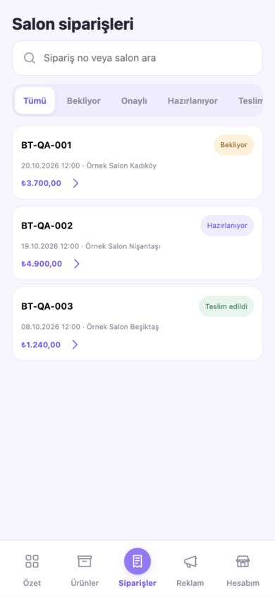
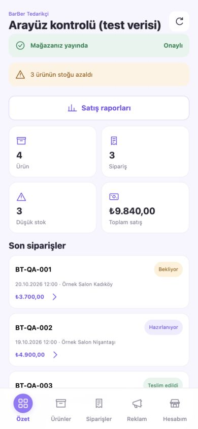

# Barber Workshop — arayüz ve işlev kontrolü

Tarih: 20 Ekim 2026. Kapsam: paylaşılan iki görseldeki hizalama, beş ana ekran, formlar ve mevcut API sözleşmeleri.

## Sonuç

Alt menüde seçili ikonun ilk harfi örtmesi ve arama simgesinin yazıdan aşağıda durması düzeltildi. Ekranlar 320, 390 ve 768 piksel genişlikte kontrol edildi. Her menü öğesinde ikon ile etiket arasında 4 piksel boşluk var; ürün/sipariş arama ikonunun giriş alanına göre merkez farkı 0 piksel. Bu kontrollerde sayfanın yatay taşması görülmedi.

Supabase Auth gerçek kimlik sağlayıcısıdır. Uygulamanın ticari verileri ise hâlâ örnek veridir: ürünler, firma profili düzenlemeleri, siparişler ve kampanyalar backend belleğinde tutulur. Bu kontrol, iş verilerini kalıcı Supabase tablolarına taşımaz.

## Düzeltilen sorunlar

| Sorun | Yapılan değişiklik | Kanıt |
| --- | --- | --- |
| Seçili alt menü ikonu etiketin başını örtüyordu | İkon ve etiket ayrı kutular; bütün durumlarda dikey flex yerleşimi ve sabit ikon alanı | `styles.css`, `app.js:nav`; 15 ekran/boyut kombinasyonu |
| Arama simgesi yazının altına kayıyordu | Yazı karakteri simgesi yerine SVG; ikon ve input aynı flex satırında merkezli | `icons.js`, `styles.css:.search`; merkez farkı 0 px |
| İkon/yazı boşlukları düğmelerde farklıydı | Ortak SVG boyutları, flex hizası, gap ve asgari dokunma yüksekliği | Mobil ekran görüntüleri |
| Android sistem çubukları için sabit 24 px kaydırma kullanılıyordu | Sistem insetleri native kapsayıcıya uygulanıyor; web alt menüsü görünür alanın dibinde | `MainActivity.java`; yeni APK kurulup açıldı |
| Filtre değişince arama metni kayboluyordu | Ürün/sipariş araması ayrı ekran durumunda tutuluyor | Node testleri ve tarayıcı arama/filtre akışı |
| “Yeni” filtresi “Bekliyor” kayıtlarını göstermiyordu | Sekme durumu kayıtlarla eşleştirildi | Tarayıcıda Bekliyor + Kadıköy: tek sonuç |
| Reklam önizlemesi daima ilk ürünü gösteriyordu | Ürün, kapsam, başlık ve not değişince önizleme yenileniyor | Tarayıcıda ikinci ürün seçimi ve fiyat kontrolü |
| Reklam notu kaydedilmiyordu | Not formdan API'ye ve kampanya kaydına bağlandı | Controller testi ve kampanya detayında aynı not |
| Pasif ürün reklama seçilebiliyordu | Formda yalnızca aktif ürünler; API pasif ürün başvurusunu reddediyor | Tarayıcı seçenekleri ve backend testi |
| Kampanya kartının detay işlemi yoktu | Kapsam, ürün, bütçe, durum ve notu gösteren detay penceresi eklendi | Tarayıcıda başvuru → detay |
| 7/30/90 gün seçimi rapor hesabını değiştirmiyordu | Tarih aralığı gerçekten uygulanıyor; günlük satışlar ve çok satanlar sipariş satırlarından hesaplanıyor | `SalesReports.java` ve deterministik tarih testleri |
| Günlük grafik ve çok satanlar uydurma dağılımdı | Sabit yüzdeler/katalog sırası kaldırıldı; günlük toplam ve satır toplamı kullanılıyor | Günlük sütunların toplamı = rapor cirosu testi |
| Para değerleri kuruşları göstermiyordu | İki ondalık basamaklı TL gösterimi | 12,50 TL test ürünü |
| Eski bir asenkron istek yeni seçilen ekranı ezebiliyordu | Ekran nesli kontrolü; eski cevaplar çizilmiyor | Geciken dashboard yanıtı testi |
| Hakediş isteği hata verirse işlenmemiş hata oluşuyordu | Yükleniyor, hata ve tekrar dene durumları | Ağ hatası testi |
| Geçersiz sayı sıfıra çevriliyor; küsuratlı stok kırpılıyordu | Sonlu/negatif olmayan sayı ve tam sayı stok doğrulaması | NaN, negatif fiyat ve 2,5 stok için 400 testi |
| Null firma bilgisi sunucu hatasına neden olabiliyordu | Alan doğrulaması ve doğrulamadan sonra toplu güncelleme | Null alan için 400 testi |

## Hâlâ mock, eksik veya ticari olarak çalışmayan alanlar

| Öncelik | Alan | Mevcut durum / etkisi | Kaynak |
| --- | --- | --- | --- |
| Yüksek | Kalıcı iş verisi | Ürün ekleme/düzenleme, kampanya ve firma düzenlemeleri yalnızca çalışan sunucunun belleğinde. Sunucu yeniden başlatılınca sıfırlanır. Supabase Auth hesapları bunun dışındadır ve kalıcıdır. | `ApiController.shops`, `Shop`, `seed` |
| Yüksek | Gerçek sipariş kabulü ve operasyon | Liste/detay/arama/filtre çalışır; siparişler seed kayıtlarıdır. Salon tarafından sipariş oluşturma, ödeme alma, durum güncelleme ve kargo entegrasyonu yoktur. | `ApiController.orders`, `order`, `seed` |
| Yüksek | Hakediş, ödeme ve fatura | Ödenen tutar 3819, komisyon oranı %14 ve fatura satırları örnektir. Transfer, gerçek fatura oluşturma/yükleme/indirme yoktur. | `ApiController.settlements` |
| Yüksek | Reklamın gerçekten yayınlanması | Başvuru ve not kaydı, listeleme ve detay çalışır; gerçek salon ekranına dağıtım, tahsilat, onay, zamanlama ve gösterim/tıklama ölçümü yoktur. Örnek “Yayında” kampanyası gerçek yayın kanıtı değildir. Bütçe bir talep alanıdır. | `ApiController.addAd`, `ads`, `seed`; `app.js:adPage` |
| Orta | Mağaza onayı | `published=true`, “Mağazanız yayında” ve “Onaylı” durumu sabittir. Başvuru inceleme/onay süreci yoktur. | `ApiController.dashboard`; `app.js:dashboard` |
| Orta | Ürün görselleri ve video kapsamı | Gerçek görsel yükleme/depolama alanı yok; SVG yer tutucular kullanılır. Minimum sipariş adedi ve ürün silme akışı mevcut değildir. | `Product` modeli; `app.js:productModal` |
| Orta | Gerçek cihaz/yayın adresi | Android API adresi emulator için `10.0.2.2:8080`; yerel geliştirmede HTTP/mixed content açık. Gerçek cihaz ve yayın için HTTPS backend adresi ve release ağ ayarları gerekir. | `app.js:API`; `AndroidManifest.xml`; `MainActivity.java` |
| Orta | Kullanım koşulları | Kayıt formunda kabul kutusu var; uygulamaya ait koşul sayfası/bağlantısı ve sürümlü kabul kaydı yoktur. | `auth.js:auth`, `doAuth` |
| Düşük | Rapor ürün kimliği | Rapor artık sipariş satırlarını toplar; satır modelinde ürün ID/SKU bulunmadığından toplama ürün adına göre yapılır. Aynı adlı farklı SKU'lar ayrıştırılamaz. | `Line`, `SalesReports.ProductSales` |
| Bilinen davranış | Uygulamayı yeniden açınca giriş | Tokenlar yalnızca arayüz belleğindedir; uygulama/sayfa yeniden açıldığında tekrar giriş gerekir. Açık oturumda yenileme mevcuttur. | `auth.js` |

## Çalıştığı doğrulanan kapsam

| Akış | Kontrol |
| --- | --- |
| Supabase Auth / özel API koruması | Auth servis sözleşme testleri; özel okuma/yazma uçlarına oturumsuz erişimde 401; yanlış token için Supabase doğrulaması; hesaplar arası ayrım |
| Ürün ekleme, düzenleme, pasife alma | Gerçek controller üzerinde izole kimlik testi; tarayıcıda ayrı test sunucusunda ekleme → stok düzenleme → arama/filtre → pasife alma |
| Sipariş arama/filtre/detay | Tarayıcı test verisinde arama korunması, tek sonuç ve doğru detay ekranı |
| Kampanya başvurusu / not / detay | Controller kaydı ve tarayıcıda ürün seçimi → önizleme → not kaydı → detay |
| Firma bilgisi düzenleme | Tarayıcı test verisinde şehir kaydı; form yeniden açılınca değer korunuyor |
| Rapor dönemleri | Backend tarih testleri; tarayıcı test verisinde 30 gün: 3 sipariş / 9840 TL; 7 gün: 2 sipariş / 8600 TL |
| Çıkış / yenileme / hata durumları | Tarayıcıda çıkışla giriş ekranına dönüş; yenileme, çevrimdışı çıkış ve geçersiz callback testleri |

## Doğrulama ve sınırlar

- Backend: 31 test, 0 hata. Kimlik/HTTP üst servisi testlerde kontrollü taklitlerle sınanır; canlı ticari veriye test kaydı yazılmaz.
- Frontend: 9 Node testi, 0 hata.
- Gradle: backend jar ve Android APK derlemesi başarılı; güncel APK emülatöre kuruldu ve açıldı.
- Görsel kontrol: 320×844, 390×844, 768×844; beş ana sekme. Ayrıntılı DOM ölçümleri: [layout-measurements.json](screenshots/layout-measurements.json).
- Görsel/etkileşim testleri `frontend-tests/serve-fixtures.mjs` ile yalnızca yerel `8081` portunda örnek verilerle yapıldı. Bu test sunucusu uygulamaya paketlenmez ve Supabase hesabı oluşturmaz.
- Bu turda gerçek ödeme, kargo, mağaza onayı veya reklam yayını doğrulanmış değildir; ilgili altyapılar mevcut değildir.

Tekrar çalıştırma:

```sh
node --test frontend-tests/*.test.cjs
./gradlew :backend:test :backend:bootJar :app:assembleDebug
node frontend-tests/serve-fixtures.mjs
```

## Görseller — arayüz test verisi




